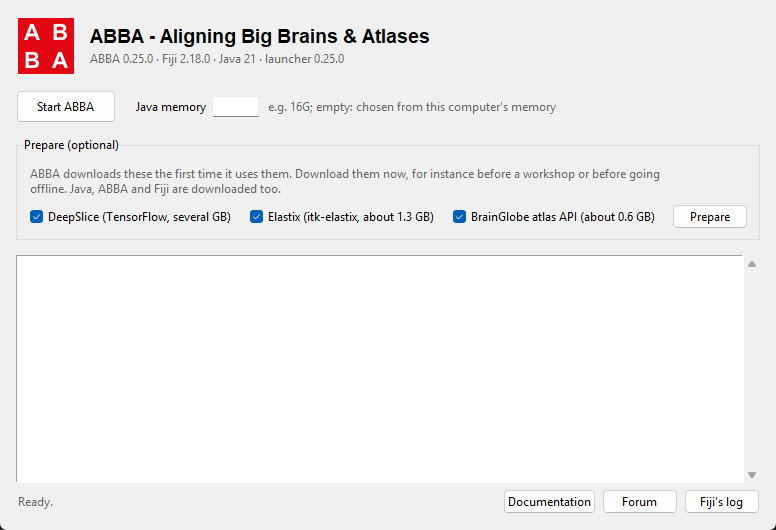

# ABBA installer

Starts [ABBA](https://abba-documentation.readthedocs.io) (Aligning Big Brains & Atlases) in its own Fiji, without
installing Fiji, Java or Python first. Windows, macOS and Linux.

It runs a **pinned** environment: the same ABBA, Fiji and Java on every computer. Your own Fiji, if you have one,
is neither used nor modified.

| ABBA | Fiji | Java |
|---|---|---|
| 0.25.0 | 2.18.0 | Zulu 21 |

DeepSlice, Elastix and the BrainGlobe atlases are not installed by this launcher: ABBA installs them itself, in
their own Python environments, the first time you use them. The launcher can download them ahead of time
(**Prepare**).

> Already have Fiji? Then you don't need this: enable the `Unige-Biochem` update site, as the
> [installation page](https://abba-documentation.readthedocs.io/en/latest/installation/installation.html)
> describes. This launcher is for a computer without Fiji, for a version that must not move, and for
> installing ABBA once for every user of a shared computer.

## Install for yourself

1. Download `ABBA-<version>.zip` from the [ABBA releases](https://github.com/BIOP/ijp-imagetoatlas/releases) and
   extract it anywhere you can write to.
2. Windows: double-click **`Start.cmd`**. macOS / Linux: run `bash start.sh` in a terminal from that folder.

That's all. The first time, `Start.cmd` installs [uv](https://docs.astral.sh/uv/) (it builds the launcher's
Python environment, and is the only thing installed outside the folder), and adds an **ABBA** shortcut to your
Start Menu and next to `Start.cmd`. Use the shortcut from then on.

The ABBA window opens. Click **Start ABBA**: the first start downloads Java, ABBA and Fiji (about 0.5 GB in
some 1900 files, up to 15 minutes; a progress bar counts them); later starts take seconds. Then start ABBA from
Fiji as usual. Closing the ABBA window leaves Fiji open.



## Install for every user of a computer (Windows)

Double-click **`Install.cmd`**; it asks for administrator rights. It installs into `C:\Program Files\ABBA` (or
the folder given as its argument) and puts an **ABBA** shortcut in the Start Menu and on the Desktop of every
user.

Everything is downloaded during the installation, so that users have nothing to fetch: the launcher and its own
Python, Java, ABBA and Fiji's jars, and the Python environments of DeepSlice, Elastix and BrainGlobe. Allow
several GB and, on a typical connection, 15 to 30 minutes (resolving the 700 jars alone takes about 15).
Users can read that folder but not write to it.

Atlases are downloaded when a user first opens one, into `C:\ProgramData\ABBA`, which every user can write: an
atlas downloaded by one user is there for all. To keep them elsewhere (a larger disk), set `ABBA_SHARED_DATA`
before running `Install.cmd`:

```bat
set ABBA_SHARED_DATA=D:\ABBA
Install.cmd
```

To update, run the new version's `Install.cmd`. To uninstall, delete the installation folder, the two shortcuts
and, with the atlases, `C:\ProgramData\ABBA`.

## Prepare

ABBA downloads DeepSlice (TensorFlow, several GB), Elastix (about 1.3 GB) and the BrainGlobe atlas API (about
0.6 GB) the first time it uses each of them. **Prepare** in the window downloads them now, for instance before
a workshop or before going offline. An installation for every user prepares all three.

## Command line

The window's actions, for a terminal or a script, from the extracted folder:

```bash
uv run abba start                    # start Fiji with ABBA; Ctrl+C stops following its output, not Fiji
uv run abba start --memory 16G       # Java's maximum heap (default: from the computer's memory)
uv run abba prepare --all            # or --deepslice --elastix --brainglobe
uv run abba info                     # versions, and where everything is
```

Extra jars, next to ABBA's: `abba start --with GROUP:ARTIFACT:VERSION` (a Maven artifact, resolved from Maven
Central and the SciJava repository) or `--add-jar file.jar`. Both repeatable; to keep them, put them in the
settings file (`abba info` shows where) as `"extra_dependencies"` and `"extra_jars"`. They add jars: they do
not change the versions ABBA is built with.

## Where things go

| What | For yourself | For every user |
|---|---|---|
| Launcher and its Python | the extracted folder (`.venv`) | the installation folder |
| Java, ABBA and Fiji's jars | jgo's and cjdk's caches in your profile | the installation folder (`java`) |
| DeepSlice, Elastix, BrainGlobe | `~/.local/share/appose` | the installation folder (`appose`) |
| Atlases | `~/cached_atlas`, `~/.brainglobe` | `C:\ProgramData\ABBA` |
| Fiji's log, settings | `%LOCALAPPDATA%\abba-installer`, `%APPDATA%\abba-installer` (`~/.local/share`, `~/.config` elsewhere) | the same, per user |

For yourself, the Python environments and the atlases are where a Fiji with ABBA on the same computer keeps
them: they are downloaded once for both.

## macOS

- DeepSlice and Elastix need an Apple-silicon Mac: no TensorFlow nor itk-elastix is published for Intel Macs.
  ABBA itself runs on both.
- Unlike `abba_python` (pyimagej), the launcher starts Fiji as a separate program, as Fiji normally runs, so
  ABBA's window should work. `start.sh` has not been tested on macOS and Linux yet: reports are welcome.

## How it works

`jgo` resolves one Maven endpoint, `ch.epfl.biop:ImageToAtlasRegister` then `sc.fiji:fiji` (ABBA first, so that
the versions it pins win), into a class path, and runs `net.imagej.Main` on a Zulu 21 fetched by `cjdk`. The
launcher fetches the JDK itself: on its own, jgo would run any Java already installed. **Prepare** runs
`prepare.groovy` headless on the same class path, which asks ABBA to build its Appose environments.

| File | Role |
|---|---|
| `src/abba_installer/launcher.py` | versions, the jgo command line, starting Fiji, preparing |
| `src/abba_installer/gui.py`, `cli.py` | the window and the command line |
| `src/abba_installer/prepare.groovy` | builds the Python environments through ABBA's own code |
| `Start.cmd`, `start.sh` | install uv if missing, then open the window |
| `Install.cmd` | the installation for every user |

## Releasing (maintainers)

The launcher's version is the ABBA version it runs, with `.post1`, `.post2`... for a fix of the launcher alone.

1. Set `ABBA_VERSION` (and `FIJI_VERSION` if needed) in `launcher.py`, the version in `__init__.py` and
   `pyproject.toml`, and the table at the top of this README; `uv lock`; `uv run pytest`.
2. `bash tools/count_downloads.sh` (about 15 minutes) and set `EXPECTED_DOWNLOADS` in `launcher.py` to what it
   prints: the progress bar of a first start counts the files jgo fetches against it.
3. Try it: `uv run abba prepare --all`, then `uv run abba start` and a registration.
4. Commit, then `bash tools/make_zip.sh`, and attach `ABBA-<version>.zip` to the ABBA release on GitHub.

The icon is drawn by `uv run --no-project --with pillow python tools/make_icon.py`.

## License

The launcher is MIT licensed ([LICENSE.txt](LICENSE.txt)). What it downloads at run time comes with its own
licenses: ABBA (BSD-3), Fiji and its components, DeepSlice (GPL-3), itk-elastix (Apache-2.0), the BrainGlobe
atlas API (BSD-3), and each atlas its own terms.

Developed by Nicolas Chiaruttini. ABBA: [ijp-imagetoatlas](https://github.com/BIOP/ijp-imagetoatlas). For an AI
assistant driving ABBA, see [abba-mcp](https://github.com/unige-biochem/abba-mcp); to drive it from Python,
[abba_python](https://github.com/BIOP/abba_python).
